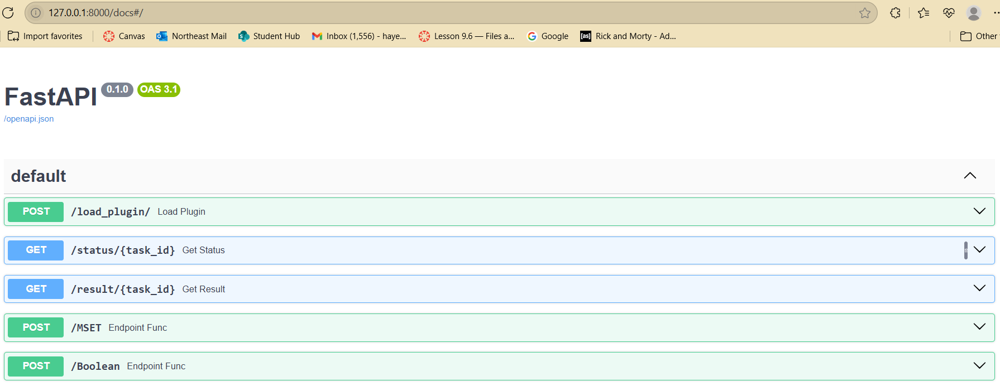
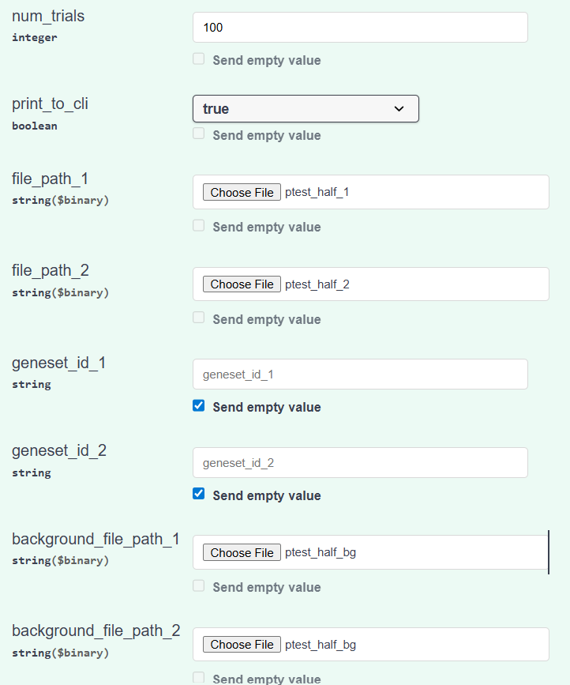
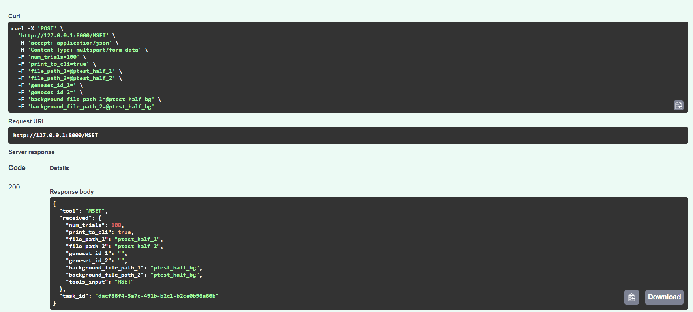
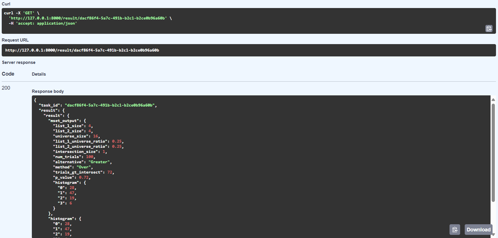

Project: Jax_GeneWeaver Backend GeneUses
Backend development on the Gene Weaver project for Jackson Laboratories.
In this project we are creating a prototype where we move the gene set tools 
on GeneWeaver to an Asynchronous Task Service. Decoupling the tool implementations
from the GeneWeaver database. These tools are implemented with just the input
and the GeneWeaver ReST API interface as end points. 

Developers:
Anushka Ashishkumar Doshi
Daniel Hayes
Harshit Khattar
Kishan Lakshman

Running the Project:

First the repository must be cloned onto your local machine.
Then inside the repository at your system path\GitHub\Jax_GeneWeaver  start a virtual python environment using the below steps

### Package Management
- **Poetry**: Dependency management and packaging
  - Installation: `pip install poetry`// Note poetry path in install and add it to system path
  - Initialize: `poetry install --with dev,docs,test,build` 
  - Virtual Environment: `poetry shell` or `& your-system-path/GitHub/Jax_GeneWeaver/.venv/Scripts/Activate.ps1`
    make sure to replace "your-system-path"

Once this is completed, the virtual environment should be running in the power shell and should look something like (jax-geneweaver-py3.11) PS your-system-path\GitHub\Jax_GeneWeaver>

### MSET Run
- **Virtual Environment**: Running the fastapi interface
  - Find fastapi file from Jax_GeneWeaver folder: `cd src` and then `cd fastapi1`
  - Run uvicorn server: `uvicorn fastapiService:app --reload`
  - Retrieve http from INFO printed out and add /docs to it - put it in a browser and go to that site.
  -  It should look like this image. Click on /MSET
  - Click on "Try it out"
  - Fill out all fields, as shown:  The files used can be found in your-system-path\GitHub\Jax_GeneWeaver\src\plugins\MSET and the path to your project should be in your powershell.
  - Click on Execute below the fields input on the website.
  - From the output on the website find task_id  which is at the bottom of this image.
  - Copy that task_id - just the id value not the "", go to the results part in , click "Try it out"
  - Paste the id value in the task_id description and execute.
  - The output should look like 
  - With this ouput the MSET tool has successfully been run!

**Note** - if you change any file locations you will need to run `poetry install` again.

With this you should be able to run the FastAPI interface for the project.
The test files can also be run as python files for further understanding.

Completed Tools:

- MSET comparison
Ran with gene set files or gene IDs
- Boolean Algebra
For same species genes.

Appendix: (Documents, etc.)

[Software Requirements Specification](https://docs.google.com/document/d/1CuAEDM0lB_aLkWd-7UbAVl1-4FK-Bd3kylNvMyXkAls/edit?tab=t.0)

[Software Design Document (Initial Version) ](https://docs.google.com/document/d/1iV7gFUhqc2Z5BtbLYyuZjCIfEyceMhUscrIj2UMRTug/edit?tab=t.0)

[Software Testing Document](https://docs.google.com/document/d/1Lk9_93cKM9bXzYuGziVMOhecGJTzI2oFd0pS3NMt780/edit?usp=sharing)
